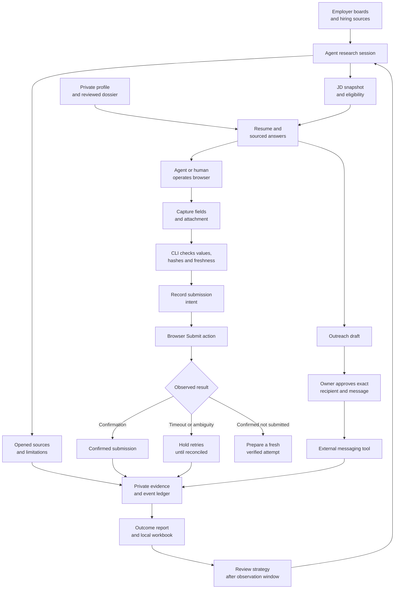

# Job Search System

Use Claude Code or Codex to help you find jobs, tailor your resume and keep track of applications. This repo gives your agent a place to save what it finds, check your facts and remember what happened between sessions.

## Start here

Open **Claude Code or Codex on your computer**, in a folder where you keep projects. Give it this prompt:

```text
Set up https://github.com/debsagar/job-search-system for my job search.
Clone it into a new folder, or use this checkout if we're already in it.
Read README.md, docs/WORKFLOW.md and job-search/examples/contracts.json.

Check the prerequisites in "Manual setup" below, create a local .venv,
install requirements.txt and run job-search/init.py. Do not overwrite
existing private files. Keep the optional paid mapper disabled.

Ask me for my resume, target roles, location/work eligibility and work
preferences. Review the experience and projects I provide with me.
Replace the fictional examples in the private profile and dossier with
confirmed facts only. Keep uncertain claims out of application material.
Save my targeting preferences in private/job-search/preferences.md.
Keep all my personal material under private/ and out of Git commits.

Run job-search/manage.py check and job-search/manage.py report
using the virtual environment's Python.
Tell me whether setup passed and what information you still need.
Do not submit applications, send messages or publish anything.
```

The agent handles the setup commands and asks you for your background. You don't need to edit JSON yourself. Use a session that can read files and run terminal commands; research also needs web access. If it cannot browse, give it the JD text or links it can open. Browser applications need browser tools or your help.

### Then just ask

**Find roles:**

> Read my saved profile, preferences and campaign history. Find up to five roles that fit me. Open the actual employer JDs, check location eligibility and explain the fit and gaps. Save the leads without duplicates. Do not apply or contact anyone.

**Tailor a resume:**

> Tailor my resume to this JD: [paste the link or text]. Choose the most relevant evidence from my whole project dossier. Don't invent claims. Save a separate one-page version and show me what changed. Do not submit it.

**Pick up tomorrow:**

> Read my private records and tell me where we left off, what needs my attention and the next useful step. Keep drafts separate from applications actually submitted.

Your records stay in the local `private/` folder, which Git ignores. Your chosen agent still processes whatever you share with it. Nothing runs automatically in the background, and this repo does not include a Claude or Codex subscription.

<details>
<summary>How it works</summary>

The agent researches roles and prepares material. The Python tools check and record its work. If a browser times out after Submit, the system holds the application for review instead of blindly retrying. A filled form is never counted as an application.

This repository contains reusable code and fictional examples, with no real candidate profile, resume, employer contacts or application history. For the technical details, continue below.

</details>

## Architecture



The Python CLI performs bookkeeping and validation. An agent session or a person must research sources, write material, inspect the browser and perform external actions. There is no bundled browser driver, model harness, email sender or scheduler. The original workflow uses T3; another agent can supply the same JSON contracts.

## Manual setup

Linux or macOS, Python 3.10+, and Poppler's `pdfinfo` are required. Core commands use the Python standard library. Workbook export additionally uses `openpyxl`.

```bash
# Ubuntu/Debian: sudo apt-get install poppler-utils
# macOS: brew install poppler
python3 -m venv .venv
.venv/bin/pip install -r requirements.txt
.venv/bin/python job-search/init.py
.venv/bin/python job-search/manage.py check
.venv/bin/python job-search/manage.py report
.venv/bin/python job-search/flow.py queue
```

Edit `private/job-search/profile.json`, `private/job-search/policy.json` and `private/WORK_DOSSIER.json`. Examples are fictional; the example project is deliberately not eligible for use until reviewed. Mark a project `usable` only after checking its contribution and evidence.

By default all runtime data is under ignored `private/`. To keep it outside the checkout, set `JOB_SEARCH_HOME` to an absolute local directory before running any command. Its parent contains `WORK_DOSSIER.json`; use a dedicated parent directory. This is local storage, not encrypted storage. Keep it out of shared folders and public deployments.

## Application lifecycle

See [JSON contracts](job-search/examples/contracts.json). Save your real input JSON under `private/`, never under examples.

```bash
python3 job-search/flow.py ingest private/job.json
# Substitute the application_id returned above for ID below.
python3 job-search/flow.py prepare ID private/preparation.json
# Now inspect/fill the actual browser form and capture what is displayed.
python3 job-search/flow.py verify ID private/readback.json
python3 job-search/flow.py intent ID
# Perform the authorized Submit click in the browser exactly once.
python3 job-search/flow.py receipt ID private/receipt.json
python3 job-search/manage.py report
```

`prepare` requires a one-page PDF, reviewed project IDs, claim/visual-review references and sourced answers. `verify` compares actual browser values to intended answers, checks the attachment hash and requires an observation captured within ten minutes. `intent` checks the current profile, PDF and preparation fingerprint again.

Receipt states are `submitted`, `not_submitted` and `unknown`. For `unknown`, inspect the employer confirmation or another authoritative receipt before resolving it. Never use `not_submitted` just because a page is empty. Confirmed receipts trigger workbook export; export failure does not erase the receipt or permit resubmission.

The CLI trusts the evidence supplied by its operator. It cannot prove that a screenshot was actually inspected, a claim is true, or an external message was approved. Readbacks must come from the browser, not be copied from intended values. Never bypass `flow.py` by writing lifecycle events directly through `manage.py`.

## Research and outreach

Use [the agent workflow](docs/WORKFLOW.md) for a bounded research heartbeat and [architecture details](docs/ARCHITECTURE.md) for data contracts and failure handling. The heartbeat is a prompt run by your chosen scheduler, not a daemon included here.

`manage.py add EVENT.json` records research notes, leads, outreach and outcomes. Outreach approval is tied to the exact recipient and message hash; an agent must check approval before sending. All messages and applications remain external actions requiring the owner's authorization.

```bash
python3 job-search/flow.py fetch 'https://api.ashbyhq.com/posting-api/job-board/BOARD'
python3 job-search/flow.py remember private/memory.json
python3 job-search/flow.py recall 'Exact question' 'https://example.com/jobs/1'
.venv/bin/python job-search/export_sheet.py
```

Exports include private answers, saved JDs and resume links. Never publish them. The report separates automatic acknowledgements from human replies and applications younger than 14 days from the mature cohort. Small samples do not establish that one channel works better.

## Optional field mapping

`jev.py` is an optional TypeSafe adapter for mapping a form field to one of a finite set of sourced facts. It is disabled with a zero budget in the example configuration. It neither invents facts nor operates the browser. The adapter is preserved from the original system; its current provider/model availability is not verified by this release.

`--dry` validates without a network request. A real call requires an explicitly enabled local configuration, an approved budget and `TYPESAFE_API_KEY` or `--prompt-key`. Supplied fields and facts are sent to that provider. Local reservations are not provider-enforced billing limits. There are no automatic paid retries.

## Offline checks

```bash
python3 job-search/test_manage.py
python3 job-search/test_flow.py
python3 job-search/test_jev.py
```

Tests use synthetic data in temporary directories and make no model calls. They cover duplicate prevention, receipt requirements, exact outreach approval, profile invalidation, incorrect readbacks, uncertain-submit recovery and mapping-budget limits. They do not prove that an ATS browser flow works or that the system improves hiring outcomes.

## Publishing your own changes

Use explicit source-file staging. Never force-add ignored runtime data. Check `git diff --cached` and `git ls-files` before pushing. Private records can include names, contact details, salaries, screening answers, resumes and access tokens. `.gitignore` is a convenience, not a security boundary.
